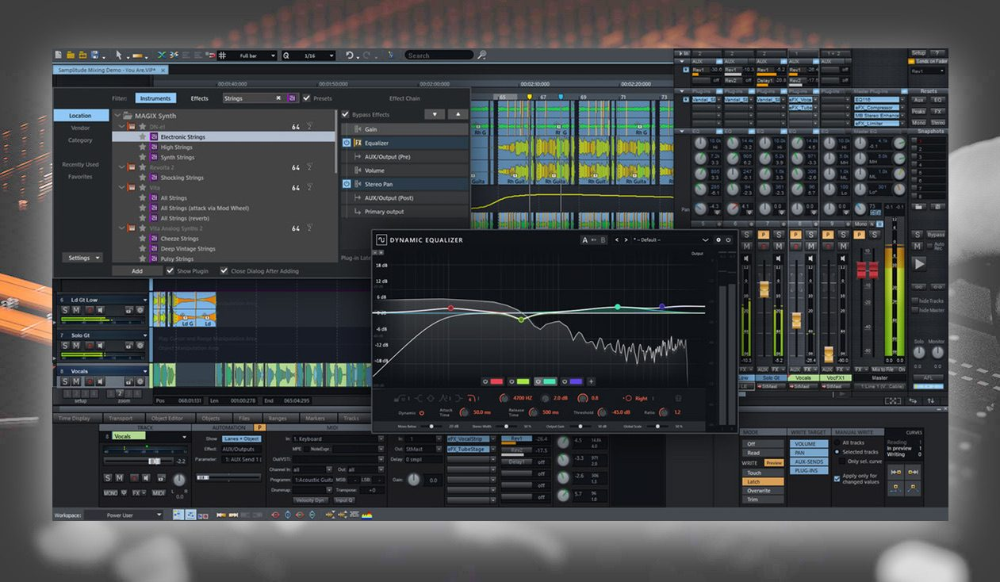
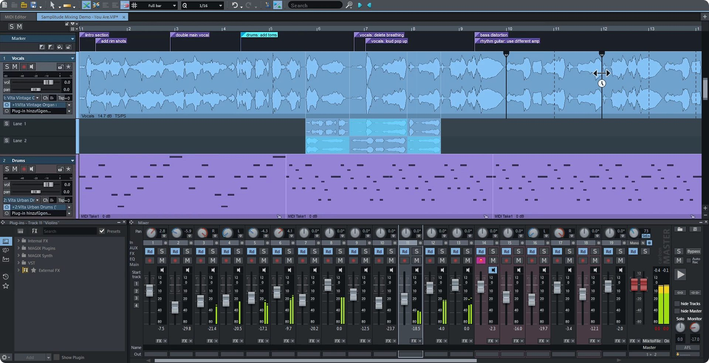

# Samplitude for Audio Recording, Editing and Mastering

Samplitude Pro workflows combine multitrack recording, detailed editing, mixing, and final audio delivery.
Magix Samplitude is a familiar historical product name; current product information and documentation are provided by Boris FX.

[](https://samplitude-pro.github.io/Magix-Samplitude/)

This independent repository collects workflow notes and selected open-source audio references.
The bundled header files belong to LMMS and do not describe Samplitude's internal implementation.

## What is Samplitude?

Samplitude is a Windows digital audio workstation for working with recorded audio, MIDI, effects, and automation.
Its object-based editing approach allows processing decisions to follow individual audio objects within a larger arrangement.

Searches for **samplitude music studio** and **samplitude pro x** can refer to different products or earlier releases.
Check the exact product and version before applying instructions.
For **boris fx samplitude suite**, also check which additional tools and third-party products are included in the package.

## Features

| Production task | Samplitude workflow | Useful review |
| --- | --- | --- |
| Record a performance | Multitrack audio recording | Inputs, monitoring, and recorded levels |
| Assemble an arrangement | Timeline and object editing | Timing, transitions, and source selection |
| Process a short passage | Object effects and object automation | The selected object and its boundaries |
| Shape a complete track | Track processing and automation | Routing and parameter changes over time |
| Build the mix | Channel, bus, and master processing | Balance, signal flow, and headroom |
| Work with instruments | MIDI editing and virtual instruments | Timing, channel assignment, and sound selection |
| Prepare delivery | Rendering and export | Range, format, and final file inspection |

Object processing is useful when a phrase needs treatment that should not affect the entire track.
Track and master processing serve broader roles in the signal path.
Keep that distinction visible when comparing an edited object with the full mix.

For an object edit, consider:

- Whether the processing should apply to one object or several selected objects.
- The transition into and out of the edited passage.
- The relationship between object gain and downstream processing.
- Any object automation that changes the result over time.



The included LMMS references offer a separate view of audio data and arrangement structures:

- [SampleBuffer.h](include/SampleBuffer.h) declares a sample-buffer interface.
- [SampleClip.h](include/SampleClip.h) declares a sample-based clip.
- [SampleTrack.h](include/SampleTrack.h) declares a sample-track type.
- [Track.h](include/Track.h) defines the shared track abstraction.
- [Song.h](include/Song.h) declares the song-level arrangement interface.

These declarations are reference material from another application.
They are not Samplitude project definitions, SDK headers, or an object-effects API.

## Configuration

A recording session needs a consistent relationship between the audio interface, driver, and project settings.
Set the intended sample rate and choose a buffer appropriate to the recording or playback task.
Review monitoring paths so that the performer hears the intended signal without an unexpected duplicate route.

Keep a session record containing:

- The audio device and driver used.
- The project sample rate.
- Input and output assignments.
- The plug-ins needed to reproduce the project.
- The location of recorded media and final exports.

For readers studying audio-engine boundaries, the LMMS collection includes:

- [AudioEngine.h](include/AudioEngine.h), the engine-level declaration.
- [AudioDevice.h](include/AudioDevice.h), an audio-device abstraction.

These headers do not establish which drivers or engine architecture Samplitude uses.
Use the installed application's settings and documentation to configure the actual recording system.

Mix decisions should be checked in the context of the complete signal path.
An effect applied to an object can interact with later track, bus, or master processing.
Compare level-matched results when deciding whether a change improves the intended sound.

Related LMMS mixer and plug-in declarations include:

- [Mixer.h](include/Mixer.h), the mixer interface.
- [EffectChain.h](include/EffectChain.h), an ordered effects-chain abstraction.
- [Effect.h](include/Effect.h), a base effect interface.
- [Plugin.h](include/Plugin.h), a shared plug-in abstraction.
- [PluginFactory.h](include/PluginFactory.h), plug-in creation and discovery interfaces.

Automation adds another layer to that signal path.
Samplitude documents object automation for volume, pan, AUX sends, and object-effect parameters.
Object automation curves can be drawn and edited; their workflow differs from recording track automation during playback.

The separate LMMS references include:

- [AutomationClip.h](include/AutomationClip.h), a container for automation data.
- [AutomationTrack.h](include/AutomationTrack.h), the automation-track declaration.
- [AutomatableModel.h](include/AutomatableModel.h), a model for automatable values.

Samplitude 2026 documentation also describes OSC remote control.
The following Python example uses the external python-osc package to center track 1's pan.
Configure Samplitude's OSC Listen port to match the chosen destination port.

```python
from pythonosc.udp_client import SimpleUDPClient

listen_port = 9000  # Example value: match Samplitude's OSC settings.
client = SimpleUDPClient("127.0.0.1", listen_port)
client.send_message("/track/1/pan", 0.5)
client.close()
```

The address and normalized center value follow Samplitude's documented OSC mapping.
The port is an example, not an asserted application default.
Use the OSC Monitor to inspect messages when testing a controller setup.

This example changes a mixer parameter when run.
It uses the OSC interface rather than a standalone Samplitude command-line renderer.

## Requirements

Use the system requirements for the specific Samplitude release and edition.
Current vendor information identifies Samplitude as a Windows application.
Included instruments, immersive-audio features, and bundled third-party tools vary by package.

For MIDI and instrument work, keep the intended controller input and instrument destination identifiable.
Check MIDI channel assignments and recorded events before diagnosing an apparent audio problem.

The bundled LMMS interfaces illustrate related concepts:

- [MidiPort.h](include/MidiPort.h) declares MIDI port handling.
- [MidiEvent.h](include/MidiEvent.h) represents MIDI event information.
- [InstrumentTrack.h](include/InstrumentTrack.h) declares an instrument-track interface.

Those interfaces are not a Samplitude MIDI scripting API.
The collection is partial and should not be assumed to build a complete LMMS application.



## Support

Before exporting, identify the exact range and mix revision intended for delivery.
Review muted or soloed tracks, effect tails, fades, and the intended output channel layout.
Choose file settings to match the delivery requirements rather than relying only on a previous export preset.

The external FFprobe utility can inspect an existing rendered file.
This command displays its first audio stream's codec, sample rate, and channel count without modifying the file.

```bash
ffprobe -v error -select_streams a:0 -show_entries stream=codec_name,sample_rate,channels -of json "mix-review.wav"
```

This is an FFmpeg tool command, not a Samplitude command.
The metadata check complements listening; it does not detect every mix, routing, or musical problem.

The LMMS rendering references are:

- [ProjectRenderer.h](include/ProjectRenderer.h), a project-rendering interface.
- [OutputSettings.h](include/OutputSettings.h), output-format settings.
- [ExportProjectDialog.h](include/ExportProjectDialog.h), the export-dialog declaration.
- [RenderManager.h](include/RenderManager.h), coordination of rendering work.

For delivery tracking, a file hash can help distinguish two revisions with similar names.
This Windows PowerShell example reads the hashes of WAV files already present in an export folder.

```powershell
Get-ChildItem -LiteralPath 'C:\AudioReview\Exports' -Filter '*.wav' -File |
    ForEach-Object {
        Get-FileHash -LiteralPath $_.FullName -Algorithm SHA256
    } |
    Select-Object Path, Algorithm, Hash
```

A hash identifies file contents for comparison.
It does not establish loudness compliance, audible quality, or correctness of the export range.
Keep delivery notes with the file settings and approved revision.

## References

The [Samplitude product page](https://borisfx.com/products/samplitude/) describes the current product and package comparison.
The [Object editor documentation](https://cdn.borisfx.com/borisfx/Documentation/samplitude-suite-2026/en/Content/Objekteditor.htm) explains object-level editing.
The [OSC documentation](https://cdn.borisfx.com/borisfx/Documentation/samplitude-suite-2026/en/Content/OSC.htm) lists supported control addresses.
The [FFprobe reference](https://ffmpeg.org/ffprobe-all.html) documents the external inspection command.

When reporting a problem, include the application version, audio device, driver, project sample rate, and affected operation.
For a plug-in issue, include its name and version and a minimal reproduction where practical.

## License

Samplitude is proprietary software distributed under the applicable vendor license terms.
The bundled LMMS headers retain their upstream licensing and attribution requirements.
This independent reference repository does not provide a Samplitude license or redistribute the application.

## Related Search Terms

Samplitude Pro, Magix Samplitude, samplitude music studio, samplitude pro x, boris fx samplitude suite, audio, daw, midi, music, vst, recording, mixing, mastering, automation, osc
